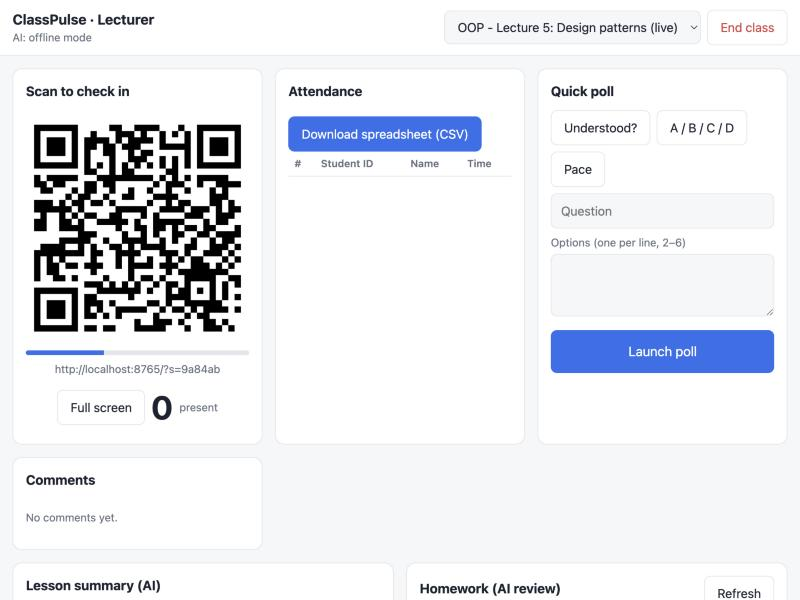

# ClassPulse: a web-based teaching tool

**Introduction to Software Engineering (OOP / OOD), Ex2: Vibe Coding & Deep Designing**

<p>


</p>

## The problem
Online teaching tools are not doing the job. Attendance is taken on paper or with a shareable
Google Form, polls need a separate paid service, student questions get lost, and nobody re-watches
a 90-minute recording. None of these tools is ready for an LLM.

## The solution
**ClassPulse** is one small web app. The lecturer runs it on a laptop and shows the dashboard on the projector.
Students scan a QR code with their phone camera. There is nothing to install and no student account.

| # | Feature | How |
|---|---|---|
| 1 | **Automatic attendance (main feature)** | A rotating QR code (HMAC token that changes every 20 s). One check-in per student and one per phone. A live table plus an Excel-ready **CSV** spreadsheet. |
| 2 | Comments and suggestions, live or offline | Anonymous by default, with upvotes. An offline outbox on the phone, and comments are accepted after class. |
| 3 | On-the-spot KISS polls | One-click templates. Live result bars over Server-Sent Events. |
| 4 | ML summary of a class video | Upload the Zoom / Meet transcript (.vtt/.srt/.txt). Summarised by Claude, with an offline extractive fallback. |
| 5 | Deep homework review vs. classmates | 3-gram similarity, missing concepts, length vs. the class average, and an LLM review. Possible copies are flagged for the lecturer. |

## Scope
**In scope:** the five features above, a responsive web UI for the student phone and the lecturer dashboard, local SQLite storage, and an optional Claude API.
**Out of scope:** Moodle, Zoom or Classroom integration; personal data beyond student ID and name; speech-to-text from raw video; native apps.
Details are in the [SoW](docs/02-SoW.md) and the [SRS](docs/03-SRS.md).

## Run it (no installs)
You need Python 3.10 or newer.
```bash
python3 run.py
```
The console prints the **lecturer URL** and **PIN**. Open the URL, log in, and click **Start**. Students scan the QR.

Options:
```bash
python3 run.py --port 8000 --pin 2468 --public-url https://my-tunnel.example.com
```
To use the real LLM (optional):
```bash
export ANTHROPIC_API_KEY=sk-ant-...
```
Without a key, the summary and review features run in offline mode.

> Phones must reach the laptop. Use the same Wi-Fi, or a **phone hotspot** if the campus Wi-Fi isolates clients.
> You can also use a tunnel and pass its address with `--public-url`.

## Tests
```bash
python3 -m unittest discover -s tests -t .
```
48 unit and integration tests, about 0.5 s, with no network needed.

## Repository layout
```
run.py                  entry point (prints URL + PIN)
classpulse/
  models.py             domain entities + DomainError
  repository.py         SQLite data access (the only place with SQL)
  tokens.py             rotating QR tokens (HMAC)
  events.py             pub/sub for live updates (SSE)
  llm.py                LLMClient interface, Claude client, fake client
  text_tools.py         transcript parsing, keywords, similarity
  app.py                composition root (dependency injection)
  web.py                HTTP router, cookies, static files, SSE
  services/             sessions, attendance, comments, polls, summary, review
static/                 student.html, lecturer.html, JS, CSS, vendored QR lib
tests/                  unit + integration tests
demo/                   sample lecture transcript + sample homework answers
docs/                   all design documents (below)
```

## Design documents (the assignment's to-do list)
| # | Task | Document |
|---|---|---|
| 1 | Repository, problem and scope | this README |
| 2 | Tools report (tested) | [docs/01-tools-report.md](docs/01-tools-report.md) |
| 3 | SoW | [docs/02-SoW.md](docs/02-SoW.md) |
| 4 | SRS | [docs/03-SRS.md](docs/03-SRS.md) |
| 5 | Use cases / client stories | [docs/04-use-cases.md](docs/04-use-cases.md) |
| 6 | Main software components | [docs/05-components.md](docs/05-components.md) |
| 7 | Class diagrams | [docs/06-class-diagrams.md](docs/06-class-diagrams.md) |
| 7 | Sequence diagrams | [docs/07-sequence-diagrams.md](docs/07-sequence-diagrams.md) |
| 8 | Testing strategy | [docs/08-testing-strategy.md](docs/08-testing-strategy.md) |
| 9 | Demo web app | `run.py`, `classpulse/`, `static/` |
| 10 | Demo in class (script) | [docs/09-demo-script.md](docs/09-demo-script.md) |
| 11 | Conclusions | [docs/10-conclusions.md](docs/10-conclusions.md) |

## Credits
- QR rendering: [qrcode-generator](https://github.com/kazuhikoarase/qrcode-generator) (MIT), vendored in `static/vendor/`.
- LLM: Anthropic Claude API (optional).
