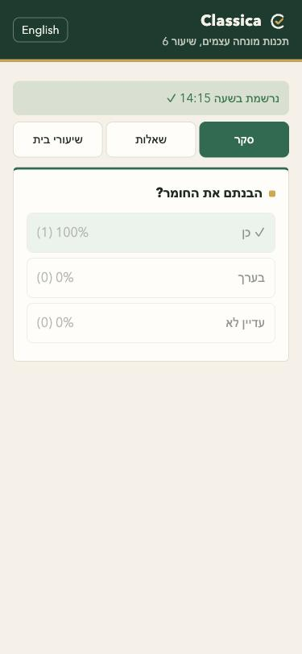

# Classica: a web-based teaching tool

**Introduction to Software Engineering (OOP / OOD), Ex2: Vibe Coding & Deep Designing**

🇮🇱 **מדריך מלא בעברית, מא׳ ועד ת׳: [PDF להורדה](מדריך.pdf) · [לקריאה באתר](מדריך.md)**

<p>


</p>

## The problem
Online teaching tools are not doing the job. Attendance is taken on paper or with a shareable
Google Form, polls need a separate paid service, student questions get lost, and nobody re-watches
a 90-minute recording. None of these tools is ready for an LLM.

## The solution
**Classica** is one small web app. The lecturer runs it on a laptop and shows the dashboard on the projector.
Students scan a QR code with their phone camera. There is nothing to install and no student account.
The screens work in **Hebrew and English** (right-to-left included).

| # | Feature | How |
|---|---|---|
| 1 | **Automatic attendance (main feature)** | A QR code and a 6-digit code that both change every 20 s. One check-in per student and one per phone. Late arrivals are marked. Optional **location check (GPS)** around the classroom. **Head count from a class photo**: the lecturer photographs the class, people are counted in the browser, and the count is compared with the check-ins. The lecturer gets a live table, an **Excel workbook** per class, a CSV, and a students × classes report for the whole course. |
| 2 | Comments and suggestions, live or offline | Anonymous by default, with upvotes. An offline outbox on the phone, and comments are accepted after class. The lecturer can mark a question as answered or hide it. |
| 3 | On-the-spot KISS polls | One-click templates. Live result bars over Server-Sent Events. |
| 4 | ML summary of a class video | Upload the Zoom / Meet transcript (.vtt/.srt/.txt). Summarised by Claude (long lectures part by part), with an offline fallback. The lecturer can edit the summary and share it with the students' phones. |
| 5 | Deep homework review vs. classmates | 3-gram similarity, missing concepts, length vs. the class average, and an LLM review. Possible copies are flagged for the lecturer only. |

## Scope
**In scope:** the five features above, a responsive web UI for the student phone and the lecturer dashboard, local SQLite storage, and an optional Claude API.
**Out of scope:** integration with Moodle, Zoom, Google Classroom or the university's student-information system ("מידע אישי"); speech-to-text from raw video; native apps.
Details are in the [SoW](docs/02-SoW.md) and the [SRS](docs/03-SRS.md).

## Run it (no installs)
You need Python 3.10 or newer.
```bash
python3 run.py
```
The console prints the **lecturer address** and the **PIN**. Open the address, log in, and click **Start**. Students scan the QR.

Options:
```bash
python3 run.py --port 8000 --pin 2468 --late-after 15 --public-url https://my-tunnel.example.com
```
To use the real LLM (optional):
```bash
export ANTHROPIC_API_KEY=sk-ant-...
```
Without a key, the summary and review features run in offline mode.

> **Phones must reach the laptop.** Use the same Wi-Fi, or a phone hotspot if the campus Wi-Fi isolates clients.
> **The location check needs HTTPS.** Browsers share a phone's location only with `https://` pages, so it works
> through an HTTPS tunnel (pass its address with `--public-url`) and not on a plain `http://192.168…` address.
> The dashboard says so when this is the case. See the [tools report](docs/01-tools-report.md#13-location-check-gps-what-is-and-is-not-possible).

## Rehearse alone: simulated students
With the server running, this fills the dashboard as if a class of 30 scanned the QR, voted, asked questions
and submitted homework. It also prints response times, so it doubles as a load test.
```bash
python3 tools/simulate_class.py --pin 2468 --students 30
```

## Tests
```bash
python3 -m unittest discover -s tests -t .
```
97 unit and integration tests, about 1 second, no network needed.

## Repository layout
```
run.py                  entry point (prints the address and the PIN)
classica/
  models.py             domain entities + DomainError
  repository.py         SQLite data access (the only place with SQL) + schema migrations
  tokens.py             rotating QR token and 6-digit code (HMAC)
  geo.py                location check: distance and the classroom circle
  ratelimit.py          sliding-window rate limiter (PIN, code, comments)
  events.py             pub/sub for live updates (public and staff channels)
  xlsx.py               minimal Excel (.xlsx) writer
  i18n.py               English / Hebrew texts for files and offline AI output
  llm.py                LLMClient interface, Claude client, fake client
  text_tools.py         transcript parsing, keywords, similarity
  app.py                composition root (dependency injection)
  web.py                HTTP router, cookies, static files, SSE
  services/             sessions, attendance, comments, polls, reports, summary, review
static/                 student.html, lecturer.html, JS (incl. i18n.js, headcount.js), CSS
static/vendor/          QR library; TensorFlow.js + COCO-SSD person detector and its model (19 MB, offline)
tools/simulate_class.py simulated phones: rehearsal and load test
tests/                  unit + integration tests
ci/                     a ready GitHub Actions workflow (not switched on yet)
demo/                   sample lecture transcript + sample homework answers
docs/                   all design documents (below)
מדריך.md / מדריך.pdf     the full guide in Hebrew (Markdown and printable PDF)
```

## Design documents (the assignment's to-do list)
| # | Task | Document |
|---|---|---|
| 1 | Repository, problem and scope | this README |
| 2 | Tools report (tested) | [docs/01-tools-report.md](docs/01-tools-report.md) |
| 3 | SoW | [docs/02-SoW.md](docs/02-SoW.md) |
| 4 | SRS | [docs/03-SRS.md](docs/03-SRS.md) |
| 5 | Use cases / client stories | [docs/04-use-cases.md](docs/04-use-cases.md) |
| 6 | Main software components | [docs/05-components.md](docs/05-components.md) |
| 7 | Class diagrams | [docs/06-class-diagrams.md](docs/06-class-diagrams.md) |
| 7 | Sequence diagrams | [docs/07-sequence-diagrams.md](docs/07-sequence-diagrams.md) |
| 8 | Testing strategy | [docs/08-testing-strategy.md](docs/08-testing-strategy.md) |
| 9 | Demo web app | `run.py`, `classica/`, `static/` |
| 10 | Demo in class (script) | [docs/09-demo-script.md](docs/09-demo-script.md) |
| 11 | Conclusions | [docs/10-conclusions.md](docs/10-conclusions.md) |

## Credits
- QR rendering: [qrcode-generator](https://github.com/kazuhikoarase/qrcode-generator) (MIT), vendored in `static/vendor/`.
- Person detection: [TensorFlow.js](https://github.com/tensorflow/tfjs) 4.22 and the [COCO-SSD](https://github.com/tensorflow/tfjs-models/tree/master/coco-ssd) model, lite MobileNet v2 (Apache 2.0), vendored in `static/vendor/tfjs/`.
- LLM: Anthropic Claude API (optional).
