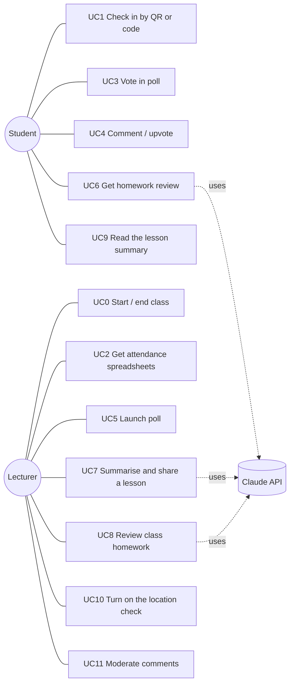

# 4. Main Use Cases (Client Stories)

## User stories
| # | As a… | I want to… | So that… | Acceptance |
|---|---|---|---|---|
| US1 | Lecturer | start a class and show a QR | students check in without me calling names | QR visible within 1 s of start |
| US2 | Student | scan once and be marked present | I don't waste class time | From the 2nd lecture: scan → done |
| US3 | Lecturer | download today's attendance as a spreadsheet | I can submit and keep records | Excel and CSV, Hebrew OK, leading zeros kept |
| US4 | Lecturer | be sure absent students can't check in from home | attendance is meaningful | A forwarded QR photo expires in ≤ 40 s |
| US5 | Student | ask a question anonymously | I'm not embarrassed | Default "Anonymous" |
| US6 | Student | send feedback after class or without signal | I can still be heard | Queued and sent automatically |
| US7 | Lecturer | ask "did you understand?" in one click | I adapt the pace | Template → live bars |
| US8 | Lecturer | get a summary of a recorded lesson and share it | students who missed class catch up | Upload .vtt → summary → on the phones |
| US9 | Student | get deep feedback on my homework vs the class | I know what I missed | Shows missing concepts and the average |
| US10 | Lecturer | see which submissions overlap heavily | I detect copying | Flagged pairs ≥ 50 % |
| US11 | Student | type a short code when my camera fails | I can still check in | 6 digits from the screen |
| US12 | Lecturer | fix the list by hand | a student with a dead phone is not marked absent | Add / remove a row |
| US13 | Lecturer | check that students are physically near the classroom | a QR photo sent live to a friend is not enough | Far phones are flagged or blocked |
| US14 | Lecturer | see attendance across the whole course | I know who keeps missing class | Students × classes table, with % |
| US15 | Lecturer / student | use the app in Hebrew | it fits our class | Language button, right-to-left |
| US16 | Lecturer | hide an unsuitable comment | the projector stays clean | Disappears from all screens |

## Detailed use cases

### UC1: Check in by QR or code (main)
- **Actor:** Student
- **Precondition:** A session is active and the QR is on the projector.
- **Main flow:**
  1. The student scans the QR with the phone camera, and the browser opens `/?s=…&t=…`.
  2. The page removes the token from the address bar so a reload can't reuse it.
  3. The first time, the student types a student ID and a name. Later they are filled in from the phone and the student is checked in automatically.
  4. If the session has a location check, the phone asks for permission and adds its position.
  5. The server validates the token, the session, the format of the ID and name, the duplicates and the location.
  6. The server saves the record (with "late" if the class started more than 15 minutes ago) and notifies the dashboard, which reloads its list.
  7. The phone shows "Checked in at HH:MM ✓" and moves on to the class view.
- **Alternative flows:**
  - 1a. The camera fails: the student opens the address shown under the QR. The page finds the open class and asks for the **6-digit code** from the screen as well.
  - 5a. The token or code expired: "The code expired. Scan the screen again, or type the 6-digit code shown now" (403).
  - 5b. The student ID was already used from another phone: "already checked in" (409). The student still enters the class view, without a second record.
  - 5c. This phone already checked in someone else: "This phone already checked in another student" (409).
  - 5d. The session has ended: "This class has ended" (409).
  - 5e. Location check in block mode and the phone is far: "You seem to be too far from the classroom" (403). No location at all: "Allow location access and try again" (403).
  - 5f. More than 10 attempts in a minute from one phone: "Too many attempts" (429).

### UC2: Get the attendance spreadsheets
1. The lecturer watches the live table during class (the online spreadsheet). Late arrivals, typed codes, manual rows and location flags are marked.
2. The lecturer clicks **Excel** and gets `class-<id>.xlsx` with three sheets (attendance, polls, comments), or **CSV** for the attendance only.
3. On the "All classes" screen the lecturer sees students × classes with a percentage, and downloads it as Excel.
4. To fix a mistake, the lecturer adds a student by hand or removes a row with ✕.

### UC3 and UC5: Polls
1. The lecturer clicks a template or types a question and its options, then clicks **Launch poll**.
2. The server closes any open poll and broadcasts the new `poll` event.
3. Phones show the options. A student taps one, and the server checks that this phone hasn't voted yet.
4. Everyone sees the percentage bars update. The lecturer clicks **Close poll**.

### UC4 and UC11: Comment, upvote, moderate
1. The student writes a comment, anonymous by default, and taps Send.
2. If the phone is offline, the comment is saved to an outbox and sent again on the `online` event or every 10 s.
3. The comment appears on the dashboard, sorted by upvotes.
4. The lecturer clicks **Answered** (the comment is greyed out and marked on the phones) or **Hide** (it disappears from the phones).

### UC6: Homework review (student)
1. The student sees the assignment question, pastes an answer or loads a file, and taps **Submit and review**.
2. The server saves or replaces the submission (only from the same phone) and compares it with the others. `SimilarityAnalyzer` computes the statistics.
3. `ReviewService` asks the LLM for a review, or uses the heuristic fallback.
4. The phone shows the statistics, a copy warning if there is one, and the review. Classmates are never named.

### UC7 and UC9: Summarise and share a recorded lesson
1. The lecturer uploads the .vtt file that Zoom or Meet saved with the recording.
2. The server converts it to plain text and summarises it with the LLM (a long lecture part by part), falling back to an extractive summary.
3. The summary is saved as a draft. The lecturer edits it if needed and clicks **Share with students**.
4. A **Summary** tab appears on every student's phone, also for students who open the class later.

### UC8: Review class homework (lecturer)
1. The lecturer types the assignment question once and saves it.
2. The Homework card lists submissions as they arrive and shows flagged pairs. The lecturer clicks **Review** for a student.
3. The lecturer gets the same review the student sees, plus the identity of the most similar classmate. A wrong submission can be deleted.

### UC10: Turn on the location check
1. On the dashboard (opened at `http://localhost…`) the lecturer chooses **Mark** or **Block** and a radius.
2. The browser asks for the laptop's location and sends it to the server as the classroom point.
3. The dashboard confirms, and warns if the students' address is not HTTPS (phones will then send no location).
4. From now on UC1 step 4 applies. The lecturer can switch it off at any time, and can always add a student by hand.
