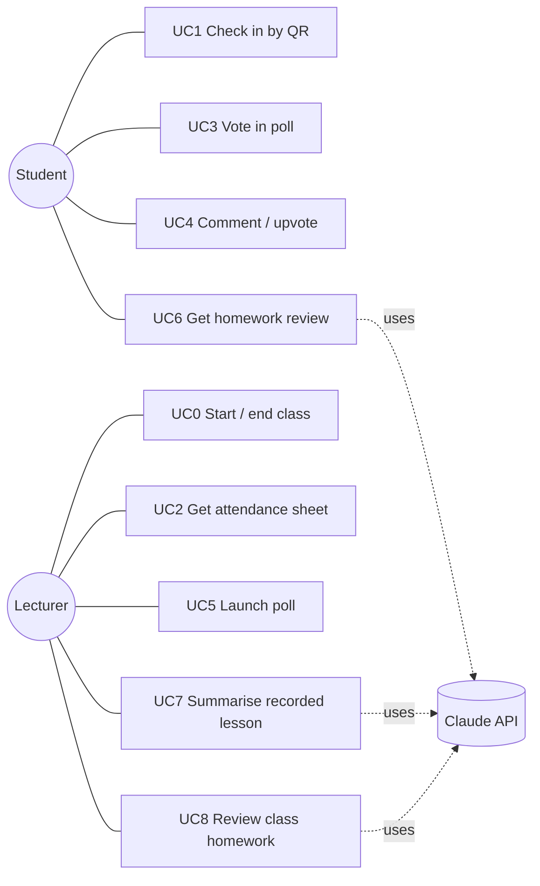

# 4. Main Use Cases (Client Stories)

## User stories
| # | As a… | I want to… | So that… | Acceptance |
|---|---|---|---|---|
| US1 | Lecturer | start a class and show a QR | students check in without me calling names | QR visible within 1 s of start |
| US2 | Student | scan once and be marked present | I don't waste class time | 2nd lecture onward: scan → done |
| US3 | Lecturer | download today's attendance as a spreadsheet | I can submit/keep records | CSV opens in Excel, Hebrew OK |
| US4 | Lecturer | be sure absent students can't check in from home | attendance is meaningful | Forwarded QR photo expires in ≤40 s |
| US5 | Student | ask a question anonymously | I'm not embarrassed | Default "Anonymous" |
| US6 | Student | send feedback after class / without signal | I can still be heard | Queued & auto-sent |
| US7 | Lecturer | ask "did you understand?" in one click | I adapt the pace | Template → live bars |
| US8 | Lecturer | get a summary of a recorded lesson | I can share notes with students who missed it | Upload .vtt → summary |
| US9 | Student | get deep feedback on my homework vs the class | I know what I missed | Shows missing concepts & avg |
| US10 | Lecturer | see which submissions overlap heavily | I detect copying | Flagged pairs ≥ 50 % |

## Detailed use cases

### UC1: Check in by QR (main)
- **Actor:** Student
- **Precondition:** A session is active and the QR is on the projector.
- **Main flow:**
  1. The student scans the QR with the phone camera, and the browser opens `/?s=…&t=…`.
  2. The page removes the token from the address bar so a reload can't reuse it.
  3. The first time, the student types a student ID and a name. Later they are filled in from the phone and the student is checked in automatically.
  4. The server validates the token, the session, the format of the ID and name, and checks for duplicates.
  5. The server saves the record and pushes an `attendance` event. The dashboard counter increases.
  6. The phone shows "Checked in at HH:MM ✓" and moves on to the class view.
- **Alternative flows:**
  - 4a. The token expired: "QR code expired – scan the screen again" (403).
  - 4b. The student ID was already used from another phone: "already checked in" (409).
  - 4c. This phone already checked in someone else: "This phone already checked in another student" (409).
  - 4d. The session has ended: "This class session has ended" (409).

### UC2: Get the attendance sheet
1. The lecturer watches the live table during class (the online spreadsheet).
2. The lecturer clicks **Download spreadsheet (CSV)** and gets `attendance-<id>.csv` with the columns #, ID, Name, Time, Session and Date (the offline spreadsheet).

### UC3 and UC5: Polls
1. The lecturer clicks a template or types a question and its options, then clicks **Launch poll**.
2. The server closes any open poll and broadcasts the new `poll` event.
3. Phones show the options. A student taps one, and the server checks that this phone hasn't voted yet.
4. Everyone sees the percentage bars update. The lecturer clicks **Close poll**.

### UC4: Comment and upvote
1. The student writes a comment, anonymous by default, and taps Send.
2. If the phone is offline, the comment is saved to an outbox and sent again on the `online` event or every 10 s.
3. The comment appears on the dashboard, sorted by upvotes.

### UC6: Homework review (student)
1. The student pastes an answer and taps **Submit & review**.
2. The server saves or replaces the submission and compares it with the others. `SimilarityAnalyzer` computes the statistics.
3. `ReviewService` asks the LLM for a review, or uses the heuristic fallback.
4. The phone shows the statistics, a copy warning if there is one, and the review. Classmates are never named.

### UC7: Summarise a recorded lesson
1. The lecturer uploads the .vtt file that Zoom or Meet saved with the recording.
2. The server converts it to plain text and summarises it with the LLM, falling back to an extractive summary.
3. The lecturer copies the summary to the course forum.

### UC8: Review class homework (lecturer)
1. The lecturer opens the Homework card, sees the submissions and any flagged pairs, and clicks **Review** for a student.
2. The lecturer gets the same review the student sees, plus the identity of the most similar classmate.
