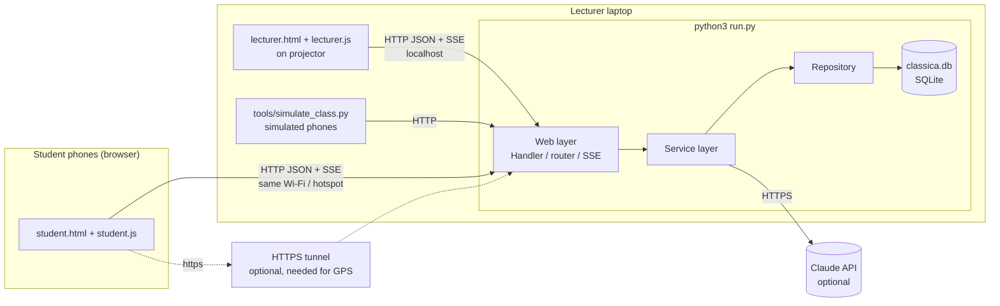

# 5. Main Software Components

## 5.1 Deployment view

## 5.2 Logical components
| Component | Module(s) | Responsibility | Depends on |
|---|---|---|---|
| **Student client** | `static/student.html`, `student.js` | Check-in (QR, typed code, location), poll, comments with an offline outbox, homework, shared summary | REST API, SSE |
| **Lecturer client** | `static/lecturer.html`, `lecturer.js` | QR and code display, live tables, manual fixes, location-check switch, polls, moderation, AI tools, course report | REST API, SSE, `vendor/qrcode.min.js` |
| **Head counter** | `static/headcount.js` | Loads the person detector on first use, scans the photo in tiles, merges boxes, lets the lecturer correct them, saves the number | `vendor/tfjs/` (TensorFlow.js, COCO-SSD, model), REST API |
| **Screen texts** | `static/i18n.js`, `common.js` | English / Hebrew dictionary, right-to-left switch, error translation by code | none |
| **Web layer** | `classica/web.py` | Routing, JSON in and out, cookies (device and lecturer), rate limiting, static files, SSE stream, mapping errors to HTTP codes | Services |
| **Composition root** | `classica/app.py`, `run.py` | Builds and wires all objects (dependency injection), reads the config | Everything |
| **Session management** | `services/sessions.py` | Session lifecycle, homework task, saved summary, geofence settings | Repository, EventBus |
| **Attendance** | `services/attendance.py`, `tokens.py`, `geo.py` | Token and code validation, anti-cheating rules, late marking, location check, manual fixes, CSV | Sessions, TokenRotator, GeoFence |
| **Reports** | `services/reports.py`, `xlsx.py` | Excel workbook per class, students × classes matrix | Repository, Workbook |
| **Polls** | `services/polls.py` | Poll lifecycle, one vote per device | Sessions |
| **Comments** | `services/comments.py` | Comments, upvotes, moderation | Sessions |
| **Summary (ML)** | `services/summary.py`, `text_tools.py` | Transcript parsing, chunking long lectures, choosing a summary strategy | `Summarizer` strategies, LLMClient |
| **Homework review** | `services/review.py` | Similarity analysis, ownership of a submission, choosing a reviewer strategy | `Reviewer` strategies, Repository |
| **LLM gateway** | `llm.py` | A vendor-neutral `LLMClient` interface, the Claude implementation, a fake for tests | stdlib `urllib` |
| **Event bus** | `events.py` | In-process publish/subscribe. Two channels per session: public (phones) and staff (dashboard only) | none |
| **Rate limiter** | `ratelimit.py` | Sliding-window limits for the PIN, the check-in code and comments | none |
| **Persistence** | `repository.py` | All SQL, thread-safe, upgrades old database files | `sqlite3` |
| **Domain model** | `models.py` | Entities and `DomainError` | none |
| **File texts** | `i18n.py` | English / Hebrew labels for CSV, Excel and offline AI output | none |
| **Simulator** | `tools/simulate_class.py` | Plays N phones against a running server: rehearsal and load test | REST API, SSE |

## 5.3 Layering rules
1. Only the **web layer** knows about HTTP. Only the **repository** knows SQL.
2. Services raise `DomainError(code, message, status)`. The web layer turns it into a JSON error, and the browser translates it by `code`. Services never format HTTP.
3. Time, the LLM and the secret are **injected**, so tests replace them with `FakeClock` and `FakeLLMClient`.
4. AI features follow the **Strategy** pattern with a mandatory offline fallback, so a missing API key never breaks the demo.
5. **Heavy work that touches personal images stays on the client.** The class photo is analysed in the lecturer's browser; the server receives only a number.
6. **Who may see what** is decided on the server: names travel only on the staff channel, and `to_dict()` methods drop device IDs, network addresses, draft summaries and the classroom coordinates.

## 5.4 REST API summary
| Method | Path | Who | Purpose |
|---|---|---|---|
| POST | `/api/login` | lecturer | Log in with the PIN, which sets a cookie (5 tries per minute) |
| POST/GET | `/api/sessions` | lecturer | Start a session or list sessions |
| GET | `/api/active` | anyone | The session that is open now (for students who typed the address) |
| POST | `/api/sessions/{id}/end` | lecturer | End a session |
| POST | `/api/sessions/{id}/homework-task` | lecturer | Set the assignment question |
| POST | `/api/sessions/{id}/geofence` | lecturer | Turn the location check on (mode, point, radius) or off |
| GET | `/api/sessions/{id}/qr` | lecturer | The current check-in URL, the 6-digit code and the seconds left |
| POST | `/api/sessions/{id}/headcount` | lecturer | Save (or clear with `null`) the number of people in the class photo |
| GET | `/api/sessions/{id}` | anyone | Title, open poll, homework task, shared summary, location-check mode |
| POST | `/api/checkin` | student | Check in (token or code, optional location) |
| GET/POST | `/api/sessions/{id}/attendance` | lecturer | The attendance table / add a student by hand |
| POST | `/api/sessions/{id}/attendance/{sid}/remove` | lecturer | Remove a record |
| GET | `/api/sessions/{id}/attendance.csv`, `/report.xlsx` | lecturer | Spreadsheets of one class (`?lang=he` for Hebrew) |
| GET | `/api/course/attendance`, `/attendance.xlsx` | lecturer | Students × classes report |
| GET/POST | `/api/sessions/{id}/comments` | anyone | List or post comments (5 per 30 s per phone) |
| POST | `/api/comments/{id}/upvote` | anyone | Upvote a comment |
| POST | `/api/comments/{id}/moderate` | lecturer | Mark answered / hide |
| GET/POST | `/api/sessions/{id}/polls` | lecturer | List or create polls |
| POST | `/api/polls/{id}/vote`, `/close` | student / lecturer | Vote, or close a poll |
| POST | `/api/summary` | lecturer | Summarise a transcript (saved as a draft of the session) |
| POST | `/api/sessions/{id}/summary` | lecturer | Save the edited summary, share or unshare it |
| POST | `/api/sessions/{id}/homework` | student | Submit homework |
| POST | `/api/sessions/{id}/homework/{sid}/review` | owner / lecturer | Review a submission |
| POST | `/api/sessions/{id}/homework/{sid}/delete` | lecturer | Delete a submission |
| GET | `/api/sessions/{id}/homework` | lecturer | Class overview and flagged pairs |
| GET | `/api/sessions/{id}/events` | anyone | SSE stream. Everyone: `poll`, `comment`, `session`. Lecturer also: `attendance`, `homework` |
