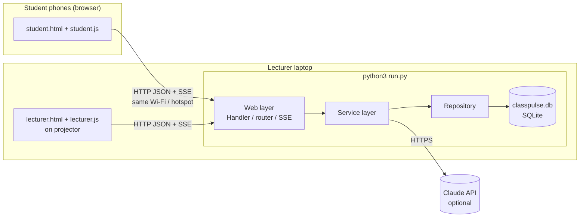

# 5. Main Software Components

## 5.1 Deployment view

## 5.2 Logical components
| Component | Module(s) | Responsibility | Depends on |
|---|---|---|---|
| **Student client** | `static/student.html`, `student.js` | Check-in, poll, comments with an offline outbox, homework | REST API, SSE |
| **Lecturer client** | `static/lecturer.html`, `lecturer.js` | QR rendering, live tables, polls, AI tools | REST API, SSE, `vendor/qrcode.min.js` |
| **Web layer** | `classpulse/web.py` | Routing, JSON in and out, cookies (device and lecturer), static files, SSE stream, mapping errors to HTTP codes | Services |
| **Composition root** | `classpulse/app.py`, `run.py` | Builds and wires all objects (dependency injection), reads the config | Everything |
| **Session management** | `services/sessions.py` | Session lifecycle | Repository, EventBus |
| **Attendance** | `services/attendance.py`, `tokens.py` | Token validation, anti-cheating rules, CSV | Sessions, TokenRotator |
| **Polls** | `services/polls.py` | Poll lifecycle, one vote per device | Sessions |
| **Comments** | `services/comments.py` | Comments, upvotes | Sessions |
| **Summary (ML)** | `services/summary.py`, `text_tools.py` | Transcript parsing, choosing a summary strategy | `Summarizer` strategies, LLMClient |
| **Homework review** | `services/review.py` | Similarity analysis, choosing a reviewer strategy | `Reviewer` strategies, Repository |
| **LLM gateway** | `llm.py` | A vendor-neutral `LLMClient` interface, the Claude implementation, a fake for tests | stdlib `urllib` |
| **Event bus** | `events.py` | In-process publish/subscribe per session channel | none |
| **Persistence** | `repository.py` | All SQL, thread-safe | `sqlite3` |
| **Domain model** | `models.py` | Entities and `DomainError` | none |

## 5.3 Layering rules
1. Only the **web layer** knows about HTTP. Only the **repository** knows SQL.
2. Services raise `DomainError(code, message, status)`. The web layer turns it into a JSON error. Services never format HTTP.
3. Time, the LLM and the secret are **injected**, so tests replace them with `FakeClock` and `FakeLLMClient`.
4. AI features follow the **Strategy** pattern with a mandatory offline fallback, so a missing API key never breaks the demo.

## 5.4 REST API summary
| Method | Path | Who | Purpose |
|---|---|---|---|
| POST | `/api/login` | lecturer | Log in with the PIN, which sets a cookie |
| POST/GET | `/api/sessions` | lecturer | Start a session or list sessions |
| POST | `/api/sessions/{id}/end` | lecturer | End a session |
| GET | `/api/sessions/{id}/qr` | lecturer | Get the current check-in URL and the seconds left |
| GET | `/api/sessions/{id}` | anyone | Get the title and the open poll |
| POST | `/api/checkin` | student | Check in |
| GET | `/api/sessions/{id}/attendance[.csv]` | lecturer | Get the attendance table or the CSV |
| GET/POST | `/api/sessions/{id}/comments` | anyone | List or post comments |
| POST | `/api/comments/{id}/upvote` | anyone | Upvote a comment |
| GET/POST | `/api/sessions/{id}/polls` | lecturer | List or create polls |
| POST | `/api/polls/{id}/vote`, `/close` | student / lecturer | Vote, or close a poll |
| POST | `/api/summary` | lecturer | Summarise a transcript |
| POST | `/api/sessions/{id}/homework` | student | Submit homework |
| POST | `/api/sessions/{id}/homework/{sid}/review` | student / lecturer | Review a submission |
| GET | `/api/sessions/{id}/homework` | lecturer | Get the class overview and flagged pairs |
| GET | `/api/sessions/{id}/events` | anyone | SSE stream with `attendance`, `poll`, `comment` and `session` events |
