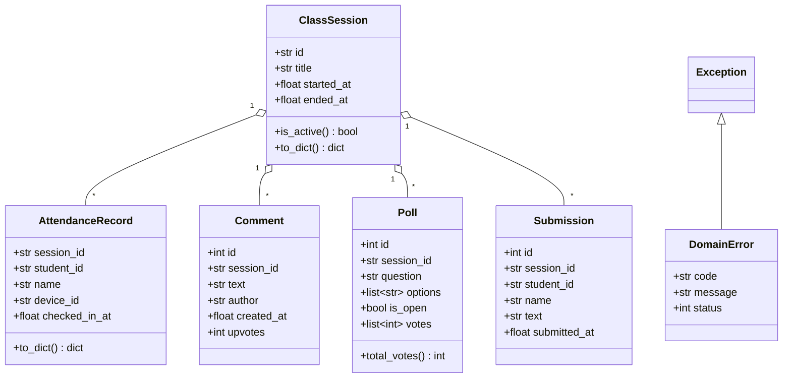
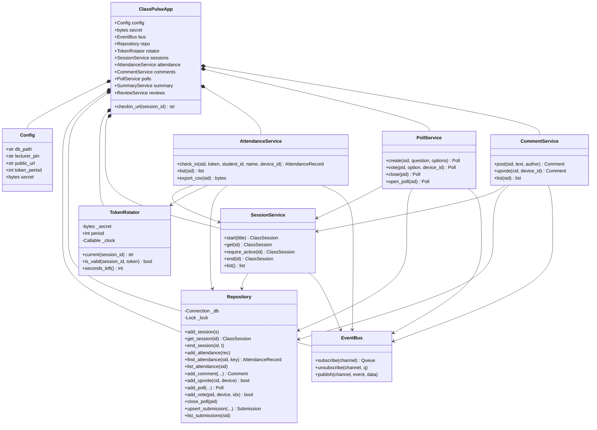
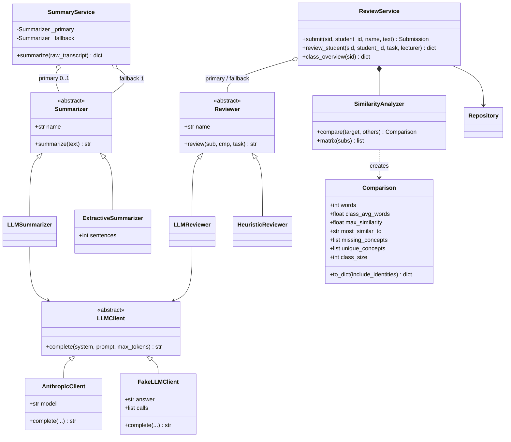
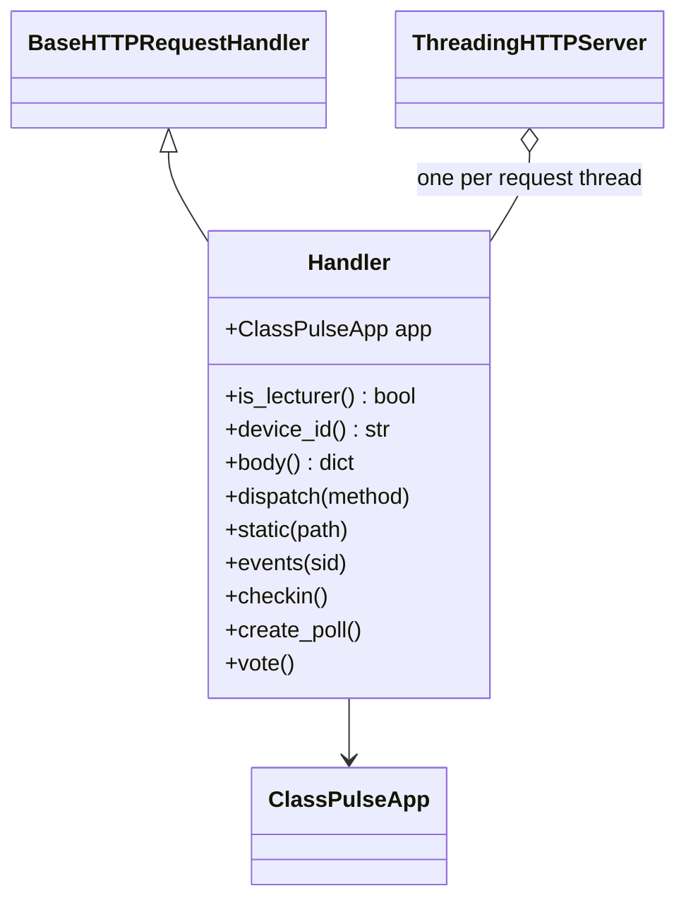

# 6. Low-level Class Diagrams

The diagrams match the code in `classpulse/`. They render on GitHub (Mermaid).

## 6.1 Domain model (`models.py`)

## 6.2 Core services (attendance, polls, comments)

## 6.3 AI services: Strategy pattern with an offline fallback

## 6.4 Web layer

## 6.5 Design decisions (OOD principles)
| Principle / pattern | Where | Why |
|---|---|---|
| **Single Responsibility** | Each service owns one feature. `Repository` owns SQL. `Handler` owns HTTP. | Each class has one reason to change |
| **Dependency Inversion** | Services depend on `LLMClient`, `Summarizer` and `Reviewer` abstractions | We can swap Claude for another LLM, or a fake |
| **Strategy** | Summarizer and Reviewer implementations | Lets the AI path and the offline path be swapped |
| **Observer (pub/sub)** | `EventBus` with SSE subscribers | Live updates without polling |
| **Repository** | `Repository` | Persistence is isolated from the domain |
| **Composition root / DI** | `ClassPulseApp` | One place builds the graph. Tests inject `FakeClock` |
| **Value objects** | dataclasses in `models.py` | Simple, comparable, serialisable |
| **Information hiding** | `AttendanceRecord.to_dict()` drops `device_id`. `Comparison.to_dict(False)` drops identities | Privacy (NFR-5) |
