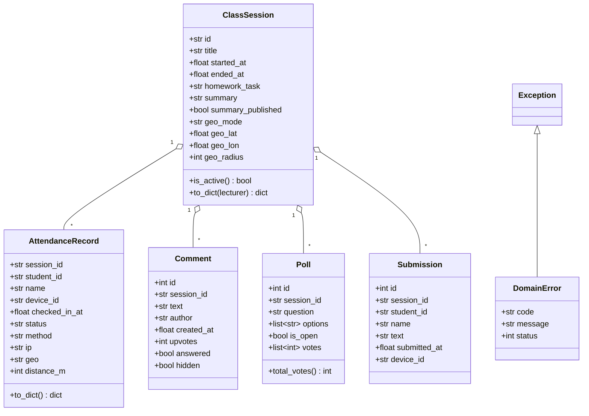
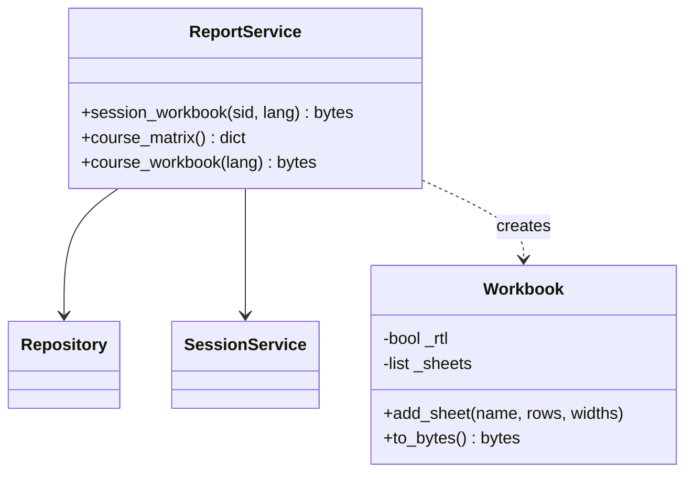
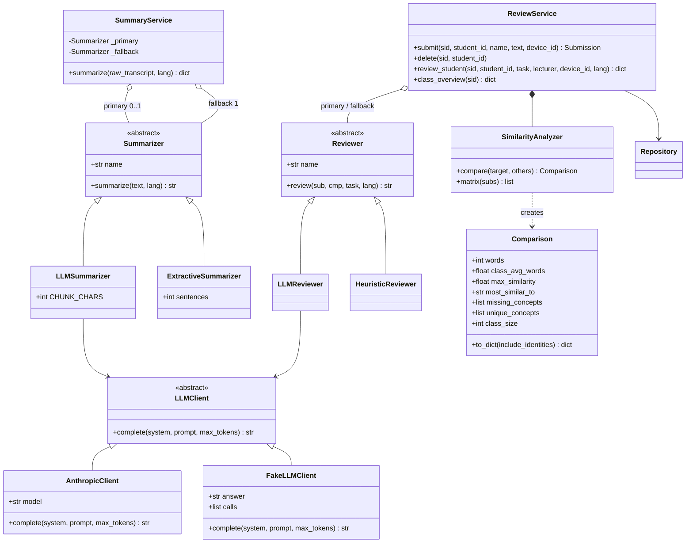
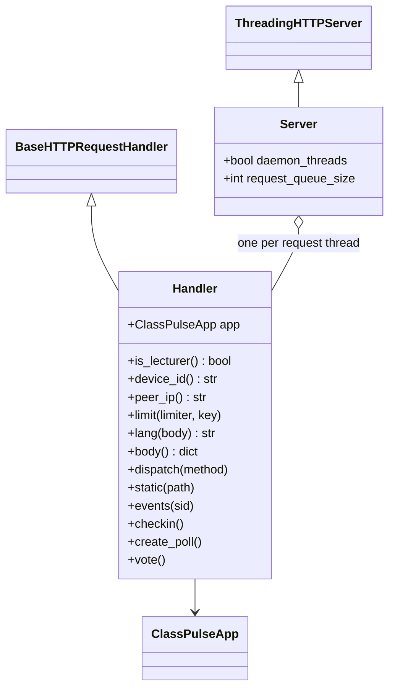

# 6. Low-level Class Diagrams

The diagrams match the code in `classpulse/`. They render on GitHub (Mermaid).

## 6.1 Domain model (`models.py`)

Notes: `status` is `on_time` or `late`. `method` is `qr`, `code` or `manual`. `geo` is empty, `ok`, `far` or `none`.
`ClassSession.to_dict(lecturer=False)` drops the classroom coordinates and an unpublished summary.
`AttendanceRecord.to_dict()` drops `device_id` and `ip`.

## 6.2 Core services (sessions, attendance, polls, comments)

```mermaid
classDiagram
  class ClassPulseApp {
    +Config config
    +bytes secret
    +EventBus bus
    +Repository repo
    +TokenRotator rotator
    +SessionService sessions
    +AttendanceService attendance
    +CommentService comments
    +PollService polls
    +ReportService reports
    +SummaryService summary
    +ReviewService reviews
    +RateLimiter login_limiter
    +RateLimiter checkin_limiter
    +RateLimiter comment_limiter
    +checkin_url(session_id) str
  }
  class Config {
    +str db_path
    +str lecturer_pin
    +str public_url
    +int token_period
    +int late_after_minutes
    +bytes secret
  }
  class Repository {
    -Connection _db
    -Lock _lock
    -_migrate()
    +add_session(s)
    +get_session(id) ClassSession
    +end_session(id, t)
    +set_homework_task(id, task)
    +set_summary(id, summary, published)
    +set_geofence(id, mode, lat, lon, radius)
    +add_attendance(rec) bool
    +find_attendance(sid, key) AttendanceRecord
    +list_attendance(sid) list
    +delete_attendance(sid, student_id) bool
    +add_comment(sid, text, author, t) Comment
    +add_upvote(cid, device) bool
    +set_comment_flags(cid, answered, hidden)
    +add_poll(sid, question, options, t) Poll
    +add_vote(pid, device, idx) bool
    +close_poll(pid)
    +upsert_submission(sid, student_id, name, text, t, device) Submission
    +list_submissions(sid) list
    +delete_submission(sid, student_id) bool
  }
  class EventBus {
    +subscribe(channels) Queue
    +unsubscribe(q)
    +publish(channel, event, data)
  }
  class TokenRotator {
    -bytes _secret
    +int period
    -Callable _clock
    +current(session_id) str
    +current_code(session_id) str
    +match(session_id, given) str
    +is_valid(session_id, given) bool
    +seconds_left() int
  }
  class GeoFence {
    +float lat
    +float lon
    +int radius_m
    +distance_to(lat, lon) float
    +contains(lat, lon, accuracy_m) bool
  }
  class RateLimiter {
    +int limit
    +float per_seconds
    -Callable _clock
    +allow(key) bool
    +reset(key)
  }
  class SessionService {
    +start(title) ClassSession
    +get(id) ClassSession
    +require_active(id) ClassSession
    +active() ClassSession
    +end(id) ClassSession
    +list() list
    +set_homework_task(id, task) ClassSession
    +save_summary(id, summary, published) ClassSession
    +set_geofence(id, mode, lat, lon, radius) ClassSession
  }
  class AttendanceService {
    -int _late_after
    +check_in(sid, token, student_id, name, device_id, ip, location) AttendanceRecord
    +add_manual(sid, student_id, name) AttendanceRecord
    +remove(sid, student_id)
    +list(sid) list
    +list_for_lecturer(sid) list
    +export_csv(sid, lang) bytes
    -_locate(session, location) tuple
  }
  class PollService {
    +create(sid, question, options) Poll
    +vote(pid, option, device_id) Poll
    +close(pid) Poll
    +open_poll(sid) Poll
  }
  class CommentService {
    +post(sid, text, author) Comment
    +upvote(cid, device_id) Comment
    +moderate(cid, answered, hidden) Comment
    +list(sid, include_hidden) list
  }
  ClassPulseApp *-- Config
  ClassPulseApp *-- Repository
  ClassPulseApp *-- EventBus
  ClassPulseApp *-- TokenRotator
  ClassPulseApp *-- RateLimiter
  ClassPulseApp *-- SessionService
  ClassPulseApp *-- AttendanceService
  ClassPulseApp *-- PollService
  ClassPulseApp *-- CommentService
  SessionService --> Repository
  SessionService --> EventBus
  AttendanceService --> SessionService
  AttendanceService --> TokenRotator
  AttendanceService --> Repository
  AttendanceService --> EventBus
  AttendanceService ..> GeoFence : creates
  PollService --> SessionService
  PollService --> Repository
  PollService --> EventBus
  CommentService --> SessionService
  CommentService --> Repository
  CommentService --> EventBus
```

## 6.3 Reports

## 6.4 AI services: Strategy pattern with an offline fallback

## 6.5 Web layer

## 6.6 Design decisions (OOD principles)
| Principle / pattern | Where | Why |
|---|---|---|
| **Single Responsibility** | Each service owns one feature. `Repository` owns SQL. `Handler` owns HTTP. `Workbook` owns the file format. | Each class has one reason to change |
| **Dependency Inversion** | Services depend on `LLMClient`, `Summarizer` and `Reviewer` abstractions | We can swap Claude for another LLM, or a fake |
| **Strategy** | Summarizer and Reviewer implementations | Lets the AI path and the offline path be swapped |
| **Observer (pub/sub)** | `EventBus` with SSE subscribers, public and staff channels | Live updates without polling, and names reach only the lecturer |
| **Repository** | `Repository` | Persistence is isolated from the domain, including schema upgrades |
| **Composition root / DI** | `ClassPulseApp` | One place builds the graph. Tests inject `FakeClock` |
| **Value objects** | dataclasses in `models.py`, the frozen `GeoFence` | Simple, comparable, serialisable |
| **Information hiding** | `to_dict()` methods drop `device_id`, `ip`, coordinates, draft summaries and classmates' identities | Privacy (NFR-5) is enforced in one place per entity |
| **Open/closed** | A new check-in rule (late marking, location) was added inside `AttendanceService` without touching the web layer or other services | Features grow without rewrites |
| **Fail safe** | `SummaryService` and `ReviewService` catch any LLM failure and fall back | The demo never depends on the network |
