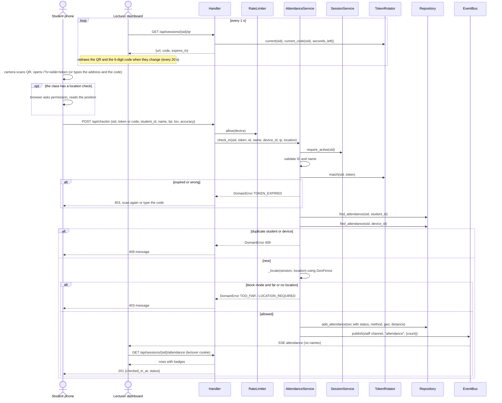
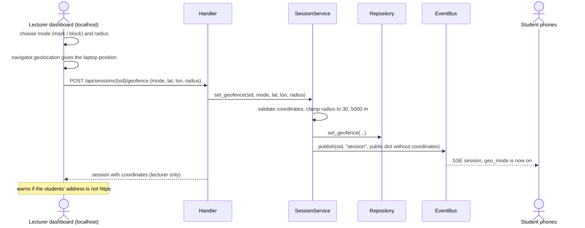
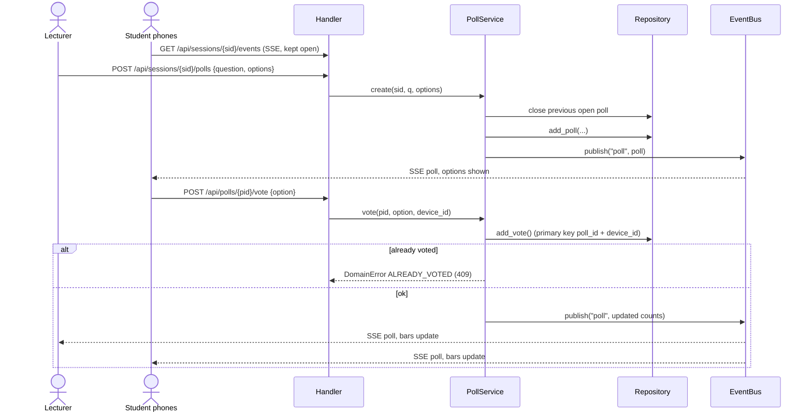
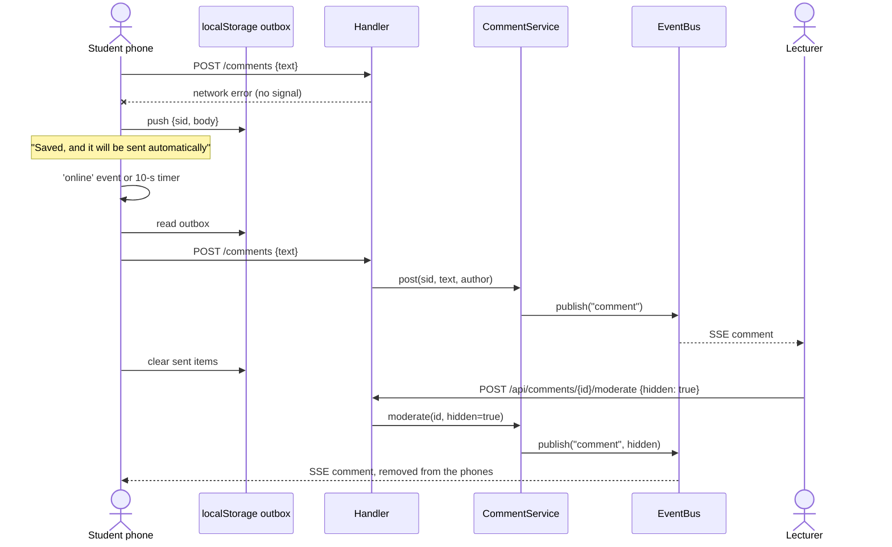
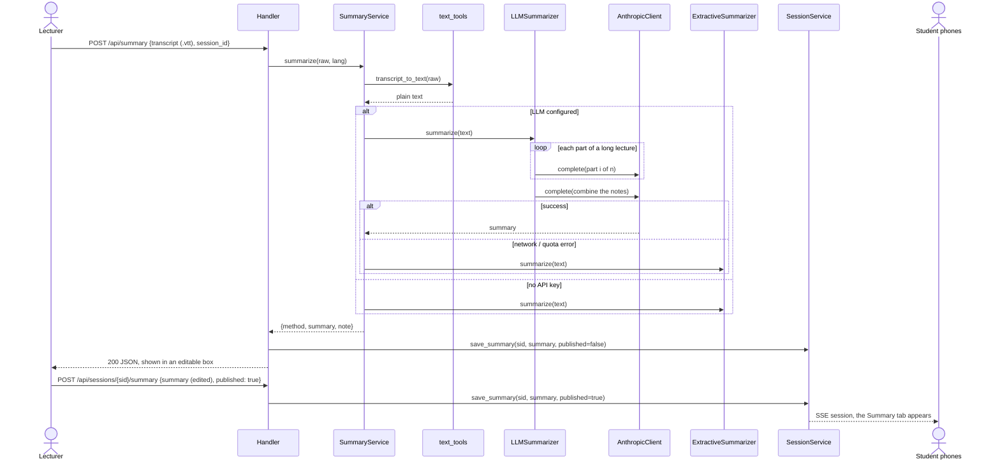
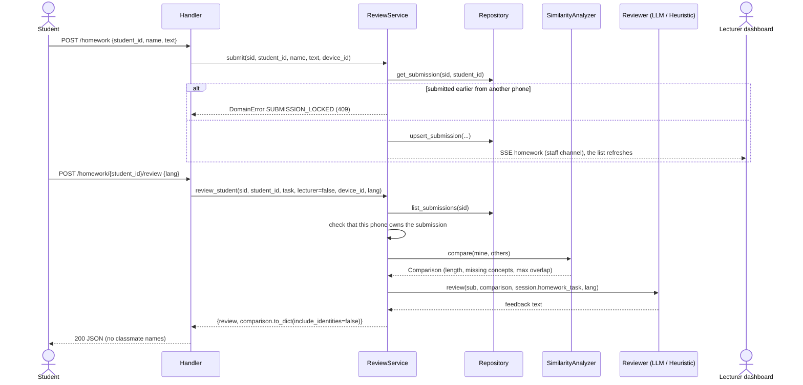

# 7. Sequence Diagrams

## 7.1 Check-in by QR or typed code (main feature)

## 7.2 Turning on the location check

## 7.3 Live poll

## 7.4 Offline comment

## 7.5 Lesson summary and sharing

## 7.6 Homework review

